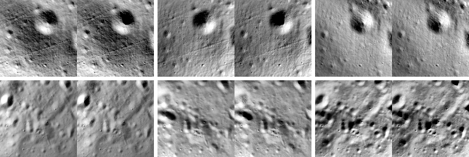

# V1 좌표계·자세 정합 시험 결과 (StereoLunar nadir·oblique)

## 결론

- **합격.** StereoLunar의 정답 자세와 LOLA DEM이 1 픽셀보다 훨씬 작은 수준으로 정합한다.
  - 깊이 잔차 중앙값은 기하 450개 전체의 중앙값이 0.000 m이고, 기하별 최댓값도 |0.24| m다. 합격 기준은 5–10 m다.
  - 영상면 이동량은 95%ile 0.009 px(0.20 m), 최대 0.019 px다.
  - ME/PA 불일치가 있다면 표면에서 ~0.8 km, 즉 3.5 km 고도에서 ~140 px의 계통 오프셋이 보여야 한다. 그런 오프셋은 없다.
- **핸드오프 §3.1의 미확인 사항을 풀었다.**
  1. "Moon-fixed Frame"은 DEM의 좌표계와 같다. 즉 **MOON_ME (DE421) 달 고정 좌표계, 기준구 R = 1,737.4 km**이다. 별도 회전이 없다.
  2. 원천 DEM은 **PDS LOLA GDR `LDEM_875S_5M`(2017, 87.5°S, 5 m, ±75.84 km 정사각형)**이다. PGDA 87S 5 m 모자이크(Barker et al. 2021)가 아니다. 근거는 아래 §3.
  3. 조명 각도 정의(§10 질문 4): 생성 코드의 "incidence"는 사실상 **고도각**처럼 쓰인다. 세 조명은 (방위, 고도) = **(330°, 20°), (250°, 20°), (180°, 15°)**다. 방위는 국지 북쪽에서 동쪽으로 잰다. 영상으로 확인했다(§4).
- **데이터셋 문서와 다른 점 네 가지를 찾았다.** 로더와 이후 시험은 모두 이 결과를 따른다.
  - EXR은 시선 방향 거리가 아니라 **z-깊이(광축 방향 거리)**다(ReadMe와 다름). 저장형은 **half float**다.
  - 픽셀 중심 규약은 **`u = col + 0.5`**다(K의 cx = W/2와 일치).
  - **조명 순서를 인덱스로 정할 수 없다.** 생성 배치의 시작 인덱스가 6의 배수가 아닌 구간이 있다. 표본 6-블록 452개 중 177개가 서로 다른 기하 두 개에 걸쳐 있었다. 조명은 같은 자세끼리 묶어 정한다(`assign_triplets`).
  - npz에는 metadata가 없다(intrinsics, cam2world만). 태양 방향은 생성 코드의 공식으로 복원했다.

## 1. 방법

| 항목 | 내용 |
|---|---|
| 데이터 | StereoLunar `nadir.zip`의 부분집합. 10번째 기하마다 조명 3종의 왼쪽 영상(1,356장)을 받고, 배치 경계에서 끊긴 삼중쌍을 채우는 177장을 더 받았다. 완전한 조명 삼중쌍 450개(영상 1,350장) |
| DEM 후보 | ① PDS `LDEM_875S_5M.IMG`(int16, ×0.5 m) ② PGDA `ldem_87s_5mpp.tif`(float32). 둘 다 MOON_ME DE421, 남극 평사도법, 5 m 격자이고 격자점이 일치한다 |
| ① 깊이 시험 | 2 px 간격(65,536 광선)으로 정답 자세의 광선을 DEM에 교차시킨다(피라미드 가속 안전 보폭 광선추적). 교차 거리(시선 거리)와 z-깊이를 EXR과 비교한다. 두 깊이지도 사이의 영상면 이동(du, dv)과 오프셋을 Gauss-Newton 정합으로 추정한다 |
| ② 렌더 시험 | 같은 자세에서 Hapke 반사(w 0.25, b −0.25, B0 1.0, h 0.06)와 투영 그림자로 렌더한다. 영상과 NCC를 구하고 위상상관 이동을 잰다. 기하 3개 중 1개(영상 450장)는 영상에서 태양 방향을 직접 추정해 복원값과 비교한다 |
| 실행 | `scripts/run_v1.py --data data/stereolunar/nadir --dems data/dem/ldem_875s_5m.img data/dem/ldem_87s_5mpp.tif --out outputs/v1/nadir` (48 프로세스, 약 25분) |

## 2. 고도 대역별 결과 (기준 DEM: PDS `LDEM_875S_5M`)

z-깊이 잔차 = EXR − DEM 교차 z-깊이. 대역은 시야 중앙 지면 거리로 가장 가까운 명목 고도(3.5 + 3k km)에 배정했다.

| 대역 (km) | 기하 수 | GSD (m/px) | 잔차 중앙값 (m) | 기하별 최대 \|중앙값\| (m) | NMAD (m) | half-float 양자화 σ (m) | 이동 95%ile (px) | 이동 95%ile (m) | 렌더 NCC 중앙값 (조명 1/2/3) |
|---|---|---|---|---|---|---|---|---|---|
| 3.5 | 57 | 5.6 | 0.01 | 0.17 | 0.74 | 0.58 | 0.010 | 0.06 | 0.953 / 0.951 / 0.929 |
| 6.5 | 56 | 10.5 | 0.00 | 0.19 | 1.48 | 1.15 | 0.009 | 0.10 | 0.928 / 0.912 / 0.907 |
| 9.5 | 54 | 15.4 | 0.02 | 0.21 | 2.97 | 2.31 | 0.011 | 0.18 | 0.916 / 0.891 / 0.883 |
| 12.5 | 55 | 20.3 | 0.00 | 0.19 | 2.97 | 2.31 | 0.010 | 0.20 | 0.933 / 0.952 / 0.935 |
| 15.5 | 51 | 25.1 | 0.01 | 0.20 | 3.37 | 2.31 | 0.007 | 0.17 | 0.948 / 0.954 / 0.938 |
| 18.5 | 42 | 29.9 | −0.02 | 0.20 | 5.93 | 4.62 | 0.007 | 0.20 | 0.951 / 0.948 / 0.934 |
| 21.5 | 41 | 34.8 | −0.01 | 0.22 | 5.92 | 4.62 | 0.006 | 0.20 | 0.959 / 0.971 / 0.950 |
| 24.5 | 39 | 39.8 | −0.01 | 0.15 | 5.92 | 4.62 | 0.006 | 0.24 | 0.955 / 0.962 / 0.954 |
| 27.5 | 37 | 44.4 | 0.00 | 0.24 | 5.93 | 4.62 | 0.006 | 0.28 | 0.963 / 0.971 / 0.958 |
| 30.5 | 18 | 49.3 | 0.02 | 0.17 | 5.96 | 4.62 | 0.005 | 0.24 | 0.963 / 0.973 / 0.959 |

- 잔차 NMAD는 EXR half-float 양자화 잡음(계단/√12)의 1.28배(중앙값)다. 남는 잡음은 DEM 쌍선형 보간과 렌더러 교차 방식의 차이로 설명된다.
- 시선 거리로 비교하면 잔차 중앙값이 −827 m로 커진다. EXR이 z-깊이라는 근거다.
- 렌더 NCC는 전체 1,350장의 중앙값이 0.945, 10%ile이 0.853이다. NaN은 3장으로, 거의 전부 그림자인 영상이다.

## 3. 원천 DEM 판별

| 근거 | PDS `LDEM_875S_5M` | PGDA `ldem_87s_5mpp` |
|---|---|---|
| 영상면 이동 95%ile / 최대 | **0.009 / 0.019 px** | 0.30 / 0.90 px |
| 이동 95%ile (m) | **0.20 m** | 2.24 m |
| 기하별 최대 \|잔차 중앙값\| | **0.24 m** | 0.96 m |
| 3.5 km 대역 NMAD | **0.74 m** | 1.19 m |
| 광선 적중률 최솟값 | 0.9995 | 0.907 (자료 공백) |

- 카메라 위치의 분포도 정사각형 경계(±75.84 km)를 따른다.
  - ρ > 76 km인 카메라는 대각선 방향(방위 44–63°, 115–143°)에만 있다.
  - "체비셰프 거리 + 시야 반폭"의 최댓값은 75.36 km다.
  - PGDA 모자이크라면 원형 영역(~100 km)까지 분포했어야 한다.
- StereoLunar 생성 코드의 텍스처 이름도 `ldem_875s_5m_heightmap.geo`다.
- 두 DEM의 차이 자체는 작다. 중앙값은 ~0.3 m, NMAD는 0.6–1.5 m, 상대 이동은 1 px 미만이다. 따라서 PGDA를 쓰더라도 V1은 통과한다. 그러나 정답 DEM은 PDS 제품이다.

## 4. 태양 방향 복원 검증

- 복원식: 생성 코드 `sun_position_local(az, inc, P_surf)`
  - dir = cos(inc)·(cos(az)·N + sin(az)·E) + sin(inc)·U
  - 기준점은 왼쪽 카메라 바로 아래의 지면점이다. nadir에서는 왼쪽 카메라의 지심 방향과 같다.
- 영상만으로 추정한 태양 방향과 비교했다(영상 450장, Hapke 렌더 NCC 최대화).
  - 방위 차: 중앙값 0.0°, |차| 90%ile 7.5°. 20° 이내가 99.3%다.
  - 고도 차: 중앙값 +1.2°, |차| 90%ile 6.2°.
- 인덱스 규칙 `(index//2) % 3`을 그대로 쓰면 배치 오프셋 구간의 영상에 다른 조명이 붙는다. 예를 들어 4320–8819 구간은 조명이 한 칸 밀린다. 렌더 시험에서 이 오류가 바로 드러났다(NCC −0.64 → 0.87).
- 반사 모델의 영향도 확인했다. Lunar-Lambert로는 NCC가 태양 고도에 거의 반응하지 않았고, 추정 고도가 15–40° 높게 치우쳤다. Hapke(위상각 의존 포함)는 시야 안의 밝기 기울기를 재현해 NCC가 0.96 안팎으로 올라가고, 고도도 바르게 구분했다. 지도 생성기의 기본 반사 모델을 Hapke로 정한 근거다(`docs/decisions.md`).

## 5. 남은 한계

- 깊이 잔차의 바닥값은 half-float 양자화가 정한다(30 km에서 계단 16 m). 고고도 대역에서 m 이하 정합은 이동 추정(Gauss-Newton)으로만 볼 수 있다.
- dynamic 궤적은 아직 받지 않았다.
- 렌더 시험의 위상상관 이동(최대 ~1.4 px)은 음영 비대칭의 영향을 받는다. 기하 정합의 판정에는 쓰지 않았다.

## 6. oblique 궤적 (추가)

- 데이터
  - `oblique.zip`에서 20번째 기하마다 받았다(`--block-stride 120`). 배치 경계로 끊긴 삼중쌍을 채우는 174장을 더 받았다.
  - 완전한 삼중쌍은 196개(영상 588장)다. 천저 이탈각은 27–59°(중앙값 40°)로, 논문의 20–35°보다 넓다.
- 실행: `scripts/run_v1.py --data data/stereolunar/oblique --dems data/dem/ldem_875s_5m.img --out outputs/v1/oblique --sun-every 0 --depth-step 4 --render-step 4`
- 결과: **합격**
  - 깊이 잔차 중앙값은 전체 중앙값 −0.02 m, 기하별 최대 |0.31| m다.
  - 영상면 이동은 95%ile 0.022 px, 최대 0.057 px다.
  - 렌더 NCC는 중앙값 0.926, 10%ile 0.832다. 0.5 미만은 0장이다.

| 대역 (km) | 기하 수 | GSD (m/px) | 잔차 중앙값 (m) | 기하별 최대 \|중앙값\| (m) | NMAD (m) | 이동 95%ile (px) | 이동 95%ile (m) | 렌더 NCC 중앙값 (조명 1/2/3) |
|---|---|---|---|---|---|---|---|---|
| 3.5 | 21 | 6.6 | 0.01 | 0.31 | 1.01 | 0.026 | 0.16 | 0.892 / 0.932 / 0.912 |
| 6.5 | 24 | 11.3 | −0.03 | 0.21 | 1.74 | 0.026 | 0.28 | 0.909 / 0.903 / 0.880 |
| 9.5 | 23 | 15.0 | 0.02 | 0.31 | 2.33 | 0.020 | 0.30 | 0.895 / 0.888 / 0.881 |
| 12.5 | 20 | 19.8 | −0.01 | 0.20 | 3.26 | 0.016 | 0.33 | 0.924 / 0.941 / 0.891 |
| 15.5 | 22 | 24.8 | −0.04 | 0.13 | 3.80 | 0.011 | 0.30 | 0.955 / 0.938 / 0.920 |
| 18.5 | 22 | 29.1 | −0.04 | 0.30 | 4.57 | 0.014 | 0.40 | 0.942 / 0.932 / 0.879 |
| 21.5 | 20 | 35.4 | 0.01 | 0.26 | 5.91 | 0.021 | 0.76 | 0.953 / 0.946 / 0.906 |
| 24.5 | 13 | 39.5 | −0.03 | 0.24 | 6.34 | 0.013 | 0.53 | 0.951 / 0.947 / 0.938 |
| 27.5 | 12 | 43.6 | −0.01 | 0.29 | 6.95 | 0.021 | 0.90 | 0.946 / 0.950 / 0.915 |
| 30.5 | 19 | 52.5 | −0.01 | 0.28 | 7.94 | 0.008 | 0.43 | 0.940 / 0.945 / 0.916 |

### 태양 기준점 수정

- 처음 oblique를 돌렸을 때 렌더 NCC가 0.5 미만인 영상이 81장(14%)이었다. 일부는 음수였다.
- 영상으로 태양을 추정해 보니 고도는 생성값(20°, 20°, 15°)과 맞았다. 방위만 기하마다 일정하게 ±70–110° 돌아가 있었다.
- 원인: 생성 코드는 방위를 **시선 목표점**의 국지 ENU에서 잰다. 로더는 카메라 바로 아래 점의 ENU를 쓰고 있었다. 극에서 수십 km 떨어진 두 점은 "북쪽"이 크게 다르다.
- 기준점을 광축과 지형의 교점(깊이 지도 중앙값)으로 바꾸자 NCC가 0.86–0.98로 회복했다(`Frame.boresight_point()`). nadir에서는 두 점이 같아 결과가 바뀌지 않는다(태양 방향 차 2×10⁻⁵°).
