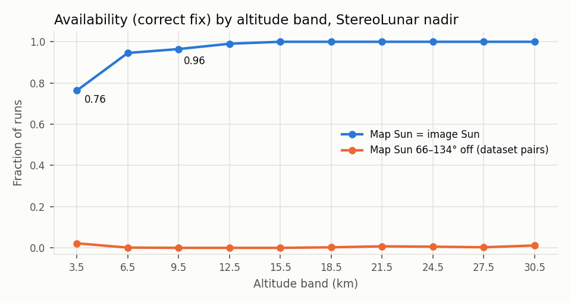
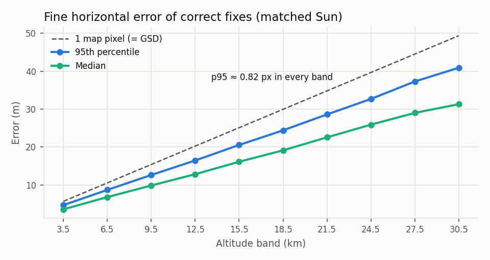
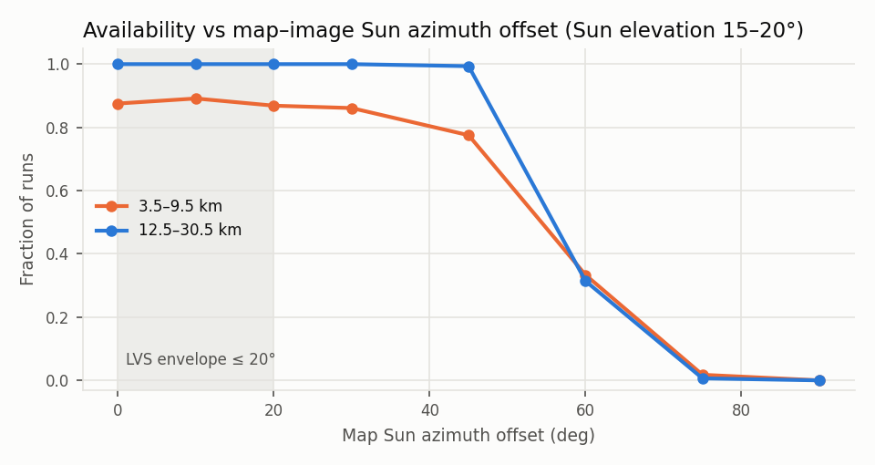

# V2·V3 결과 — StereoLunar nadir, 단일 영상

## 결론

| 시험 | 기준 (핸드오프 §6) | 결과 | 판정 |
|---|---|---|---|
| V2a 거친 단계 | 조명 일치, 수평 ±3 km·수직 ±120 m 초기 오차에서 수평 오차 99%ile ≲ 200 m (LVS 158 m) | 대역별 99%ile **39–84 m** (거친 단계가 성공한 실행 기준) | 합격 |
| V2b 정밀 단계 | 수평 오차가 지도 픽셀 2–3개 이내, inlier ≥ 20이 대부분 | 대역별 95%ile **0.81–0.84 px**(4.7–40.9 m). inlier 중앙값 91. 고정 실행은 모두 inlier ≥ 20 | 합격 |
| V2c 무결성 | inlier ≥ 20 게이트를 통과한 오고정 0건, 상한 ≈ 3/N 보고 | 조명 일치 6,066회 **0건**(상한95 0.05%). 조명 불일치를 포함한 18,198회 전체도 **0건**(상한95 0.02%) | 합격 |
| V3 조명 | 대역별 가용성과 오차 저하 보고, 문헌 경향과 비교 | 태양 각도 차 ≤ 28°에서 가용성 변화 거의 없음, 42°에서 고고도 ≥ 0.98, **56°에서 0.2–0.4, ≥ 70°에서 ≈ 0**. 데이터셋 조명 쌍(66–134°)은 0–2%. 오고정 0건 | 보고 |

- 가용성(정답 고정 비율)은 조명 일치에서 3.5 km 76%, 6.5 km 95%, 9.5 km 97%, 12.5 km 99%, 15.5 km 이상 100%다.
- 3.5 km의 고정 실패 183회 중 180회는 거친 단계에서 났다. 원인은 두 가지다.
  1. **사전 오차에 비례하는 시차.** 사전 오차 < 1 km면 가용성 93%, 1–2 km면 83%, 2–3 km면 69%다. 남극 지형의 km급 기복 때문에, 틀린 사전 자세로 와핑한 영상이 (높이차 × 시선 기울기)만큼 일그러진다. LVS 운용범위의 기복 상한은 150 m였다.
  2. **그림자.** 영상의 어두운 화소(< 0.02)가 50%를 넘으면 가용성이 6%(3.5 km), 0%(6.5 km)로 떨어진다.
- 실제 하강에서는 높은 고도에서 먼저 고정하므로 저고도 사전 오차가 작다. 연속 영상 필터(P9)가 저고도 가용성을 올릴 수 있는 이유다.

## 1. 방법

| 항목 | 값 |
|---|---|
| 데이터 | StereoLunar nadir 부분집합의 완전한 조명 삼중쌍 450개 중 평가 표본 337개(보정 표본 113개 제외, `decisions.md` F1) |
| 실행 | (기하 337) × (지도 조명 3) × (영상 조명 3) × (사전 6) = 18,198회. 대각 6,066회가 V2, 비대각 12,132회가 V3 |
| 지도 | 원천 DEM(PDS `LDEM_875S_5M`)을 이 레포의 Hapke 렌더러로 정사 렌더. 정밀 = 명목 대역 GSD, 거친 = 1.5×GSD, 태양 쪽 12 km 그림자 확장 |
| 사전 오차 | 수평: 반경 3 km 원판 안 균등. 수직: ±120 m 균등. 자세: 정답(σ 0.01°) |
| 판정 | 고정(inlier ≥ 20)이면서 수평 오차 ≤ 3 정밀-지도 px면 정답 |
| 실행 명령 | `scripts/run_v2.py --data data/stereolunar/nadir --dem data/dem/ldem_875s_5m.img --out outputs/v2/nadir --split eval --image-illums all --trials 6`, 집계는 `scripts/analyze_v2.py` (40 프로세스, 72분) |

## 2. V2 — 조명 일치 (대역별)

| 대역 (km) | GSD (m) | 실행 | 가용성 | 오고정 | 오고정 상한95 | 거친 성공 | 거친 오차 p99 (m) | 정밀 오차 p50/p95 (m) | p95 (px) | 수직 \|e\| p95 (m) | inlier 중앙값 |
|---|---|---|---|---|---|---|---|---|---|---|---|
| 3.5 | 5.6 | 774 | 0.764 | 0 | 0.0039 | 0.767 | 39 | 3.6 / 4.7 | 0.82 | 1.1 | 91 |
| 6.5 | 10.5 | 756 | 0.946 | 0 | 0.0040 | 0.952 | 48 | 6.8 / 8.7 | 0.83 | 2.1 | 91 |
| 9.5 | 15.4 | 738 | 0.965 | 0 | 0.0041 | 0.970 | 59 | 9.8 / 12.6 | 0.82 | 2.8 | 91 |
| 12.5 | 20.3 | 738 | 0.991 | 0 | 0.0041 | 0.991 | 58 | 12.8 / 16.4 | 0.81 | 3.0 | 91 |
| 15.5 | 25.1 | 684 | 1.000 | 0 | 0.0044 | 1.000 | 54 | 16.1 / 20.5 | 0.82 | 3.4 | 91 |
| 18.5 | 29.8 | 576 | 1.000 | 0 | 0.0052 | 1.000 | 84 | 19.1 / 24.4 | 0.82 | 4.8 | 91 |
| 21.5 | 34.8 | 540 | 1.000 | 0 | 0.0055 | 1.000 | 70 | 22.5 / 28.6 | 0.82 | 5.0 | 91 |
| 24.5 | 39.7 | 522 | 1.000 | 0 | 0.0057 | 1.000 | 58 | 25.9 / 32.7 | 0.82 | 5.0 | 91 |
| 27.5 | 44.3 | 522 | 1.000 | 0 | 0.0057 | 1.000 | 65 | 29.0 / 37.3 | 0.84 | 6.3 | 91 |
| 30.5 | 49.3 | 216 | 1.000 | 0 | 0.0138 | 1.000 | 65 | 31.3 / 40.9 | 0.83 | 6.5 | 92 |

- 자세 오차 95%ile은 0.002–0.004°다. 사전 자세(σ 0.01°)를 MAP 사전으로 넣었기 때문이다(`decisions.md` D6). 자세를 풀어 두면 근연직·좁은 시야에서 기울기와 수평 위치가 맞바뀌어 수십 m 오차가 난다(`tests/test_pose.py`).
- 재투영 RMS 중앙값은 0.07–0.08 px, inlier 비는 0.91–0.92다. 실행 시간 중앙값은 1.1 s(30.5 km)에서 11.4 s(3.5 km)다. 40 프로세스 동시 실행 기준이다.

### 정밀도 바닥 ~0.6 px와 공분산

- 정답 고정의 오차 중앙값은 모든 대역에서 약 0.65 px다. 같은 렌더러로 만든 합성 장면에서는 0.01 px다(`tests/test_localize_synthetic.py`). 따라서 이 바닥은 기하가 아니라 **겉모습 차이**에서 온다. 데이터셋 영상(SurRender, Hapke, PSF)과 이 레포의 지도(우리 Hapke, PSF 없음)가 다르다.
- 이 오차는 랜드마크 사이에 공통이다. 재투영 RMS가 0.07 px로 작은데 해 전체가 어긋난다. 태양 방향으로 더 크게 흩어지고(3.5 km에서 태양 방향 σ 2.3–3.1 m, 수직 방향 1.4–3.3 m), 평균은 태양 반대쪽으로 ~0.3 px 치우친다.
- 랜드마크 독립 잡음만 가정한 공분산은 이 오차를 3.6배 과소평가했다. 보정 표본으로 공통모드 바닥(축별 0.47 px, 수직 0.085 px)을 정해 공분산에 더했다(`decisions.md` D7b). 바닥을 넣으면 평가 표본에서 2σ 안에 99.8%가 들어간다.
- 본 연구(V6)에서는 이 항이 렌더러 편향 항이다. sim2moon UE 렌더와 같은 방식으로 재야 한다.

## 3. V2c — 무결성

- 오고정은 조명 일치 6,066회, 전체 18,198회에서 모두 0건이다. 단측 95% 상한은 각각 0.05%, 0.02%다.
- 고정 중 오고정 비율의 상한은 0.05%다(고정 5,809회 기준). 고정된 실행의 inlier 최솟값은 20이다.
- 대역별 상한(≈ 3/N)은 0.39–1.38%다. 대역마다 수백 회라 대역별 무결성은 이 정도까지만 말할 수 있다. 10⁻³보다 엄격한 대역별 주장을 하려면 대역마다 수천 회가 필요하다.
- 고정 없음 판정의 대부분은 거친 단계에서 끝나 정밀 추정 자체가 없다. 거친 단계는 성공했지만 게이트에서 거부된 12회는 inlier가 11–14개였고, 오차가 0.5–1.0 px로 실제로는 맞았다. 20 게이트가 가용성을 잃게 한 사례다. 게이트 아래의 원신호는 `runs.jsonl`에 모두 남아 있어 ROC로 게이트를 다시 정할 수 있다.

## 4. V3 — 데이터셋 조명 쌍 (지도 조명 × 영상 조명)

모든 대역을 합친 가용성. 괄호는 지도–영상 태양 방향 사이 각이다.

| 지도 \ 영상 | 측면 (330°, 20°) | 머리 위 (250°, 20°) | 역광 (180°, 15°) |
|---|---|---|---|
| 측면 | **0.957** (0°) | 0.000 (74°) | 0.000 (134°) |
| 머리 위 | 0.012 (74°) | **0.963** (0°) | 0.014 (67°) |
| 역광 | 0.000 (134°) | 0.004 (67°) | **0.953** (0°) |

- 데이터셋의 세 조명은 모두 태양 고도 15–20°이고 방위만 70–150° 다르다. 이 차이에서는 고전 정합기가 무너진다는 문헌 경향(LVS 운용범위 ≤ 20°, 30–60°에서 붕괴)과 같다.
- 무너져도 오고정은 없었다. 게이트가 고정을 거부했다(V2c 전체 0건에 포함).

## 5. V3 — 지도 태양 방위 오프셋 스윕

- 방법
  - 평가 표본에서 4번째 기하마다(85개)를 쓴다. 영상은 조명 일치 3종이다.
  - 지도를 영상 태양에서 방위만 +Δ 돌려(고도 유지) 렌더한다. Δ = 10, 20, 30, 45, 60, 75, 90°, 사전 4개씩, 7,140회를 실행했다. 0°는 §2의 같은 기하 실행이다.
  - 태양 고도가 15–20°라서 두 태양 방향 사이 각은 Δ의 약 0.93배다(괄호).
- 결과(가용성)

| 대역 (km) | 0° | 10° (9°) | 20° (19°) | 30° (28°) | 45° (42°) | 60° (56°) | 75° (70°) | 90° (83°) |
|---|---|---|---|---|---|---|---|---|
| 3.5 | 0.77 | 0.77 | 0.76 | 0.72 | 0.65 | 0.41 | 0.05 | 0.00 |
| 6.5 | 0.91 | 0.92 | 0.87 | 0.89 | 0.80 | 0.28 | 0.00 | 0.00 |
| 9.5 | 0.96 | 1.00 | 0.98 | 0.98 | 0.89 | 0.30 | 0.00 | 0.00 |
| 12.5 | 1.00 | 1.00 | 1.00 | 1.00 | 0.98 | 0.37 | 0.00 | 0.00 |
| 15.5 | 1.00 | 1.00 | 1.00 | 1.00 | 0.98 | 0.32 | 0.00 | 0.00 |
| 18.5 | 1.00 | 1.00 | 1.00 | 1.00 | 1.00 | 0.26 | 0.00 | 0.00 |
| 21.5 | 1.00 | 1.00 | 1.00 | 1.00 | 1.00 | 0.32 | 0.00 | 0.00 |
| 24.5 | 1.00 | 1.00 | 1.00 | 1.00 | 1.00 | 0.33 | 0.00 | 0.00 |
| 27.5 | 1.00 | 1.00 | 1.00 | 1.00 | 1.00 | 0.32 | 0.05 | 0.00 |
| 30.5 | 1.00 | 1.00 | 1.00 | 1.00 | 1.00 | 0.19 | 0.00 | 0.00 |
| 정밀 오차 p95 (px, 전 대역) | 0.82 | 0.83 | 0.87 | 0.93 | 1.21 | 1.81 | 2.09 | – |

- **낭떠러지는 태양 각도 차 42–56° 사이에 있다.** 42°까지는 12.5 km 이상에서 가용성이 0.98 이상이다. 56°에서 0.2–0.4, 70°에서 거의 0이 된다. §4의 데이터셋 조명 쌍(66–134°)이 전멸한 것과 맞는다.
- 정확도는 가용성보다 먼저 나빠진다. p95가 0°의 0.82 px에서 45° 1.21 px, 60° 1.81 px로 커진다. 오고정 허용치(3 px)에는 아직 여유가 있다.
- 이 기준선은 LVS 운용범위(태양 각도 차 ≤ 20°)보다 넓게 견딘다. 다만 이 시험은 **지도와 영상이 같은 DEM**이고 방위만 바꾼 조건이다. 실제 지도(다른 DEM, 다른 반사율)에서는 여유가 줄어든다. 문헌의 "고전 정합기는 30–60°에서 붕괴"와 방향은 같고, 붕괴 지점은 그 범위의 위쪽 끝이다.
- 스윕 7,140회에서도 오고정은 0건이다. 조명이 틀려 정합이 무너질 때도 게이트가 고정을 거부했다.

## 6. 한계

- nadir 궤적만 평가했다. oblique(천저 이탈 27–59°)는 V1만 했다(`v1_frames.md` §6). V2는 다음 세션에 한다.
- 지도와 영상이 같은 DEM이다(낙관 편향). "진실 ≠ 지도" 구성은 본 연구(sim2moon)에서 한다.
- 그림자 확장 12 km를 넘는 차폐는 지도에서 빠진다(`decisions.md` B4).
- 단일 영상이다. LVS는 거친 단계에 영상 3장, 정밀 단계에 연속 영상과 EKF를 쓴다.
